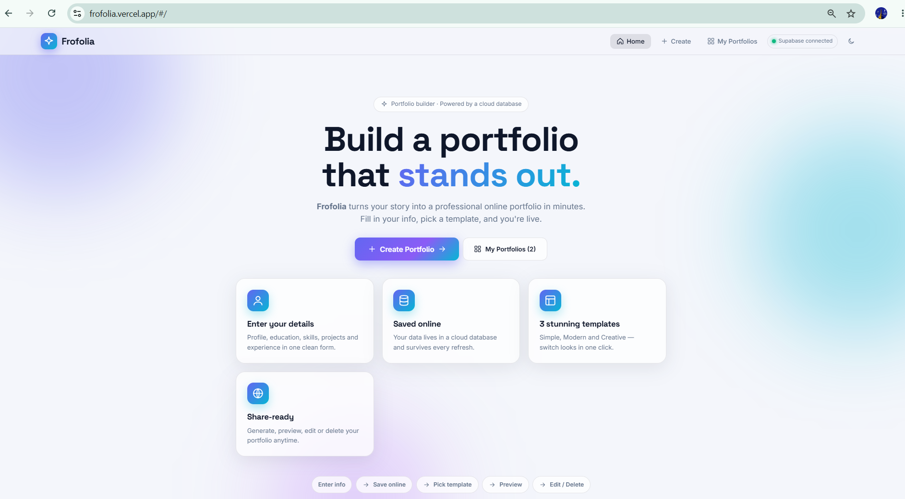
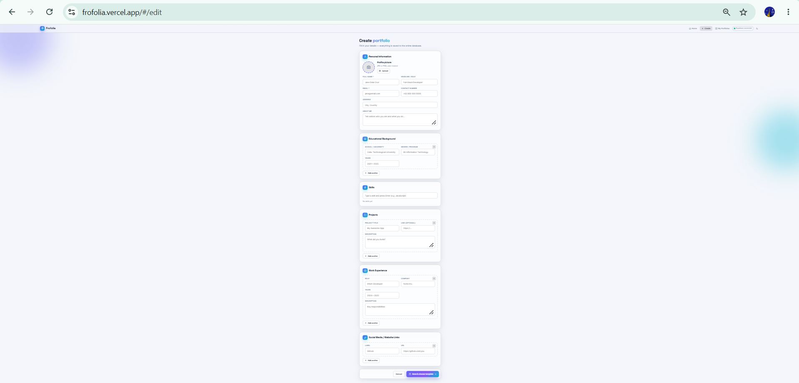
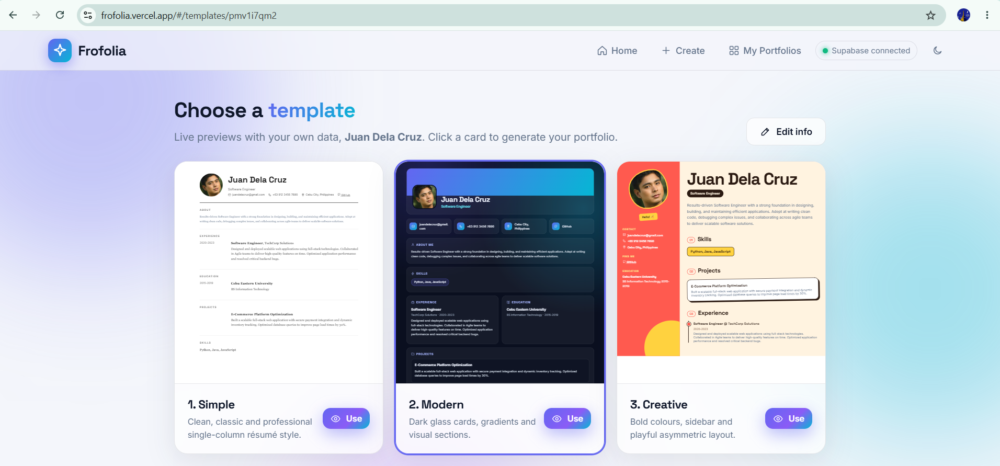
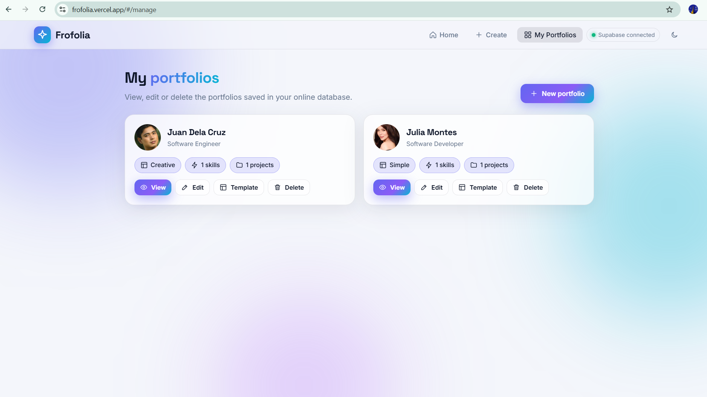
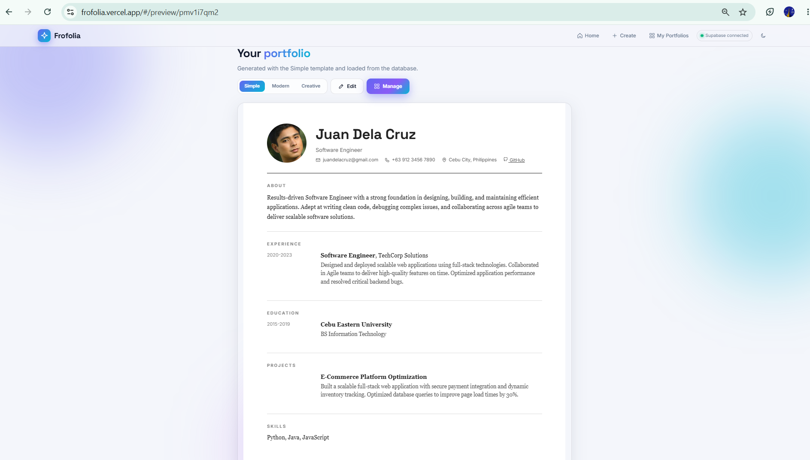
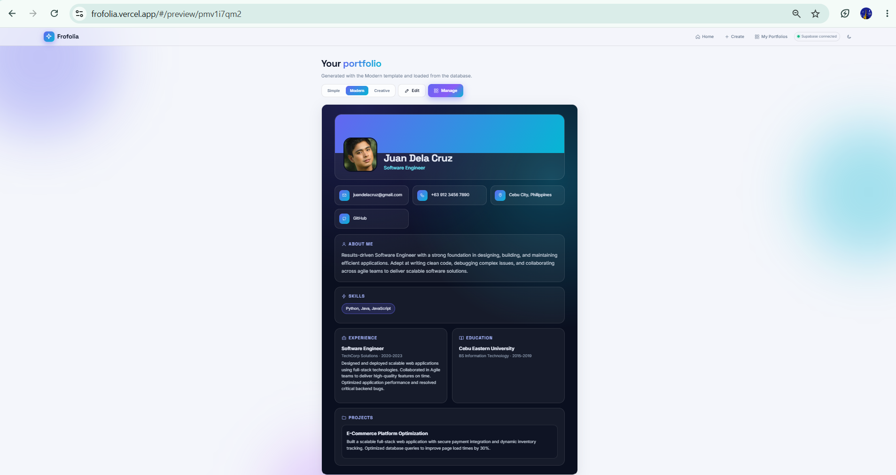
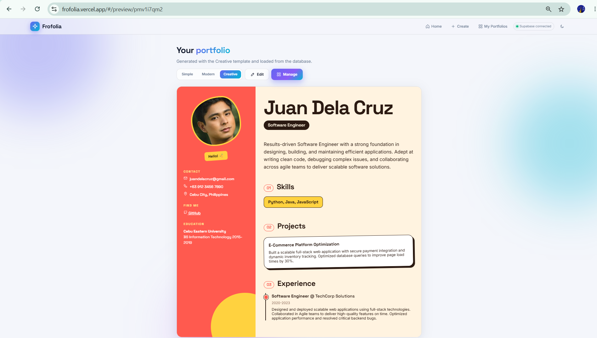
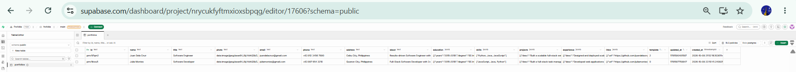
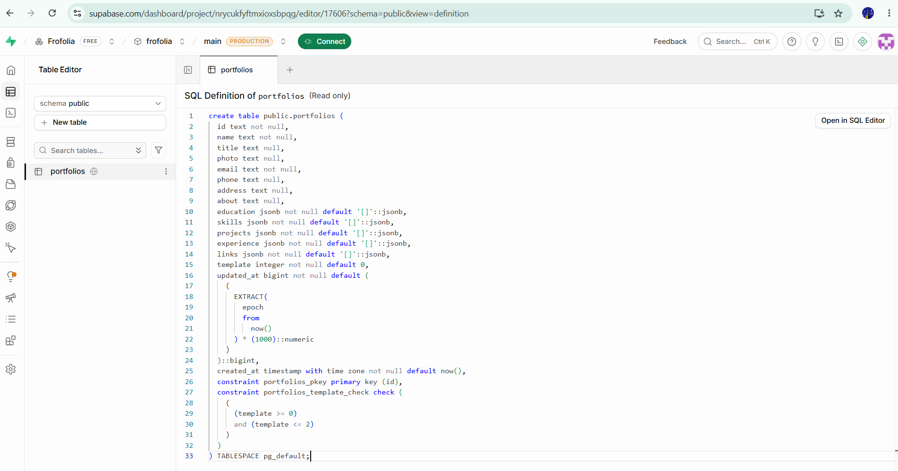

# Frofolia — Online Portfolio Template Generator

## Project Title
Frofolia – Online Portfolio Template Generator

## Project Description
Frofolia is a database-driven website where users enter their personal, educational, skill, project and work-experience information, save it to an online database, choose one of three portfolio templates (Simple, Modern, Creative), and generate, preview, edit or delete their portfolio.

## Technologies Used
- HTML5, CSS3, JavaScript (vanilla, no build step)
- Supabase JavaScript client (supabase-js v2)
- Google Fonts (Inter, Space Grotesk)

## Database Platform
- Database: Supabase (PostgreSQL, cloud-hosted)
- Database Project: Frofolia
- Access: Row Level Security enabled with public policies for the class project. Only the public anon key is used in the website; no secret keys are in the source code.

## Hosting / Deployment Platform
- Vercel (static site)

## Database Structure — table `portfolios`
| Column      | Type        | Description                              |
|-------------|-------------|------------------------------------------|
| id          | text (PK)   | Unique portfolio ID                      |
| name        | text        | Full name (required)                     |
| title       | text        | Headline / role                          |
| photo       | text        | Profile picture (resized, base64)        |
| email       | text        | Email (required)                         |
| phone       | text        | Contact number                           |
| address     | text        | Address                                  |
| about       | text        | About me                                 |
| education   | jsonb       | List of {school, degree, years}          |
| skills      | jsonb       | List of skill names                      |
| projects    | jsonb       | List of {title, link, desc}              |
| experience  | jsonb       | List of {role, company, years, desc}     |
| links       | jsonb       | List of {label, url} social/website links|
| template    | int         | Selected template: 0 Simple, 1 Modern, 2 Creative |
| updated_at  | bigint      | Last update time (milliseconds)          |
| created_at  | timestamptz | Creation time                            |

## CRUD Mapping
- Create → `upsert` on Save
- Read → `select` on Manage / Preview
- Update → `upsert` on Edit
- Delete → `delete` on Manage

## Screenshots of the System

### Home Page

### Portfolio Information Form

### Template Selection Page

### Manage Portfolio Page

## Screenshots of the 3 Templates

### Template 1 – Simple

### Template 2 – Modern

### Template 3 – Creative

## Database Screenshots

### Table Data (Supabase)

### Table Structure (Supabase)

## Published Website URL
https://frofolia.vercel.app
